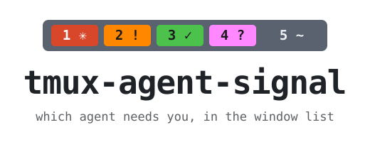
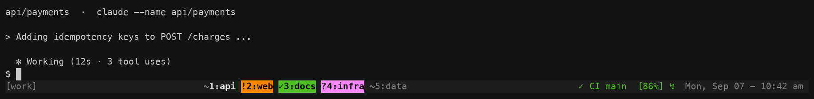

<div align="center">

<picture>
  <source media="(prefers-color-scheme: dark)" srcset="docs/img/logo-dark.svg">
  
</picture>

**Know which agent needs you, from the tmux status bar.**

[Install](#install) · [Keys](#keys) · [Configuration](docs/configuration.md) · [Commands](docs/commands.md) · [Comparison](docs/comparison.md) · [Changelog](CHANGELOG.md)

[](https://github.com/jward7/tmux-agent-signal/actions/workflows/ci.yml)


[](LICENSE)

</div>

---

You run five coding agents in five tmux windows. Which one is waiting on a
permission? Which one finished while you were reading a diff? This plugin
puts the answer in the window list you already look at, colours the tab,
and gives you one key to jump to whichever needs you most.



Each tab carries its agent's state in front of the name: orange `!` is
blocked on a permission, pink `?` is asking a question, green `✓` finished
while you were elsewhere, a dim `~` is working. A green tab turns back to
normal the moment you look at it. In a two-pane window the pane that needs
you gets its half of the border in the same colour, and `prefix + N` lands in
that pane. Nothing else on the bar is the plugin's.

## Why

- **No daemon, no polling, no sidebar.** The agent's own lifecycle hooks write
  a few tmux options. The status line reads them natively. Nothing runs on
  redraw.
- **Triage, not just a badge.** Permission prompts, questions and finished
  turns are told apart. `prefix + N` goes to the most urgent window that has
  waited longest. Flag a window as *wait* or *park* to skip it.
- **Done means done.** A green tab clears itself the moment you look at it,
  and a turn that finishes in front of you never nags.
- **One look, no theme to configure.** The plugin sets the two window-tab
  formats to `<badge><index>:<name>`, colours a tab only while its agent
  needs you or has finished, and in a two-pane window colours that pane's
  border the same way.
  Everything else in your status line and your border styles is yours, and
  `uninstall` puts it all back.
- **Small and tested.** About 800 lines of POSIX `sh`, and a test suite that
  starts a real tmux server, pipes real hook JSON through the real script and
  asserts on the options. CI runs it on macOS and Ubuntu.
- **Any agent.** Claude Code is wired up out of the box, as a tmux plugin or a
  Claude Code plugin. Codex CLI, Pi, OpenCode, Gemini CLI, Copilot CLI, Grok
  CLI and Antigravity CLI have ready-made hook files in
  [`integrations/`](integrations/). Anything that can run a shell command
  can report with `agent-signal set blocked`.

## States

| State     | Badge | Tab and pane border | Meaning                                              |
|-----------|-------|------------|------------------------------------------------------|
| working   | `~`   | unchanged  | agent is running a turn (dim, so it never competes)  |
| blocked   | `!`   | orange     | a permission prompt is waiting on a keypress          |
| ask       | `?`   | pink       | a question or plan approval is waiting on an answer   |
| done      | `✓`   | green      | finished since you last looked at that window        |
| idle      |       | unchanged  | at the prompt and you've seen it, or no agent here   |
| wait      | `…`   | dim tab    | you've flagged it: skip in `next` until it changes   |
| park      | `p`   | dim tab    | you've flagged it: skip in `next` until you unpark   |

A window with several agent panes shows the most urgent one
(blocked > ask > done > working). Sounds play for blocked, ask and done, only
when the window is not on screen. With `@agent_signal_title on`, the outer
terminal's title carries the count too: `[2 need you] session:window`.

<details>
<summary>How "seen" works</summary>

`done` flips to idle automatically when you view the window. If a turn
finishes in the window you are already looking at, it never shows `done`.
"Looking at" means the window is shown in a focused terminal: with one
session per terminal tab, a finish in a background tab still shows `done`,
and focusing that tab clears it (needs `focus-events on`; a terminal that
never reports focus counts as always focused). blocked and ask always show
through a wait or park.
</details>

## Keys

All `prefix +`, all configurable.

| Key | Action |
|-----|--------|
| `N` | go to the next blocked window, else ask, else done; within a tier, the one that has waited longest; in a split window, into the pane that needs you |
| `A` | switcher popup: sessions > windows > panes with state (needs fzf) |
| `W` | toggle **wait** on the current window |
| `P` | toggle **park** on the current window |

Inside the switcher: `enter` go, `ctrl-x` close the selected pane, window or
session (asks first), `ctrl-w` wait, `ctrl-p` park, `esc` quit.

## Install

Requirements: tmux 3.1+ and `/bin/sh`. Optional: `jq` (hook JSON parsing and
the hook installer; a sed fallback is used without it), `fzf` for the
switcher, `afplay` (macOS) or `paplay` (Linux) for sounds.

### 1. The tmux side

With [tpm](https://github.com/tmux-plugins/tpm), **after** any theme plugin so
the badge is appended to the theme's window format:

```tmux
set -g @plugin 'jward7/tmux-agent-signal'
```

then `prefix + I`.

<details>
<summary>Without tpm, or with an <code>if-shell</code>-sourced plugin list</summary>

Clone anywhere and add to the end of `~/.tmux.conf`:

```tmux
run-shell '/path/to/tmux-agent-signal/agent-signal.tmux'
```

If your plugin list lives in a file that tmux `if-shell`-sources, tpm cannot
see `@plugin` lines there; use `@tpm_plugins` instead, see
[Recommended setup](docs/recommended-setup.md).
</details>

### 2. The agent side

**Claude Code.** The repo is also a Claude Code plugin:

```
/plugin marketplace add jward7/tmux-agent-signal
/plugin install tmux-agent-signal@jward7
```

New sessions report immediately; running ones after `/reload-plugins`. The
plugin carries its own copy of the script and wires the tmux server up on
its first event, so it works even before tpm has loaded the tmux side.

<details>
<summary>Prefer hooks in your own <code>~/.claude/settings.json</code>?</summary>

Run once (needs `jq`; merges with any existing hooks and keeps a backup):

```sh
~/.tmux/plugins/tmux-agent-signal/bin/agent-signal install-claude-hooks
```

or copy [`docs/claude-hooks.json`](docs/claude-hooks.json) in by hand, then
open `/hooks` in a running session so Claude reloads its config. The full
event-to-state mapping is in [docs/commands.md](docs/commands.md#claude-code-hook-mapping).
</details>

**Codex, Pi, OpenCode, Gemini, Copilot, Grok, Antigravity.** Each has a
directory in [`integrations/`](integrations/) with the hook file to drop in
and its event table. Any other agent:

```sh
agent-signal set working|blocked|ask|done [pane-id]
agent-signal clear [pane-id]
```

### 3. Check it

```sh
agent-signal check         # reports what is wired on this server and what is missing
agent-signal set blocked   # the current tab should turn orange
```

> [!TIP]
> `sh docs/demo.sh` builds a throwaway server showing every state, with no
> agents involved. `tmux -L demo attach` to look around, `tmux -L demo
> kill-server` to bin it.

## Configuration

The badges and colours are fixed. Sounds, notifications, keys, the terminal
title and the alert command are options you set in `tmux.conf` before the
plugin loads. The common ones:

```tmux
set -g @agent_signal_tab_colour needs   # colour tabs only for blocked and ask
set -g @agent_signal_sound off
set -g @agent_signal_notify on          # desktop banner via terminal-notifier / notify-send
set -g @agent_signal_title on           # "[2 need you]" in the terminal title
set -g @agent_signal_key_next ''        # unbind a key
```

The full list, including sounds and a hook for running your own command on
every state change, is in [docs/configuration.md](docs/configuration.md).
The needs-you count is published as `@agent_needs` for your own
`status-left` or title format.

## More

- [Command reference](docs/commands.md): every subcommand, the Claude hook
  mapping, nesting agents, uninstall.
- [Recommended setup](docs/recommended-setup.md): resurrecting agents after a
  tmux restart, naming Claude sessions, the tmux settings Claude Code wants.
- [How it compares](docs/comparison.md): feature table against
  tmux-agent-state, the two tmux-agent-status projects, gentle-agent-state and
  herdr.
- [How it works](docs/how-it-works.md): the option names, the lock, the
  seen hook.
- [Troubleshooting](docs/troubleshooting.md)

## Development

```sh
sh test/run.sh              # every test/t-*.sh, each on its own isolated tmux server, in parallel
sh test/run.sh hooks next   # just those features
sh scripts/lint.sh          # shellcheck, checkbashisms and a function-size check, as CI runs them
```

**Regenerating the demo GIF.** `sh docs/record-demo.sh` rebuilds
`docs/demo.gif` from the demo server: it respawns the panes with a plain `sh`
so nothing from your own shell shows, walks the states on a timer, records
with [asciinema](https://github.com/asciinema/asciinema) and converts with
[agg](https://github.com/asciinema/agg). Install notes, including prebuilt
binaries for Macs without Homebrew bottles, are at the top of the script.
Re-run it whenever a badge, colour or the status line changes.

Tests are real: each file starts a fresh server, loads the plugin, pipes hook
JSON through the real script and asserts on tmux options. The integrations
for agents other than Claude Code were written from vendor docs and are not
exercised against the real agents here, so reports from people who run them
are the most useful contribution.

## License

MIT
